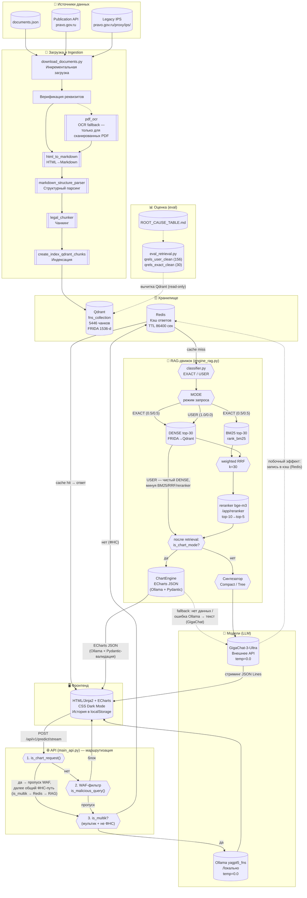

# Архитектура multik_bot — документ для ГНИВЦ

**Дата:** 23.10.2026
**Цель:** Обзор архитектуры программного комплекса multik_bot (Кадровый консультант RAG) в контексте проекта ФНС России.

> ⚠️ **Оговорки:**
> 1. Документ фиксирует состояние кода на момент проверки, а не утверждённую архитектурную схему.
> 2. На момент написания отсутствует независимая инвентаризация используемых библиотек
>    (requirements.txt / pyproject.toml не верифицированы на полноту).
> 3. Внешние зависимости (Qdrant, Redis, Ollama, GigaChat) описаны по фактическому использованию
>    в коде; их версии и конфигурация в целевой среде могут отличаться.
> 4. Схема отражает логику, а не топологию сети/размещение по хостам.

---

## 1. Общая архитектура (Mermaid)



---

## 2. Ключевые блоки

### 2.1. Ingestion pipeline
- **Загрузка**: `download_documents.py` — двухэтапное разрешение (publication API → legacy IPS), инкрементальное.
- **Верификация**: проверка реквизитов загруженного документа.
- **Конвертация**: HTML → Markdown (BeautifulSoup + pandoc) — основной путь.
- **OCR** (отдельная ветка, резерв): `pdf_ocr` — только для сканированных PDF, когда HTML недоступен или недостаточен.
- **Структурный парсинг**: `markdown_structure_parser.py` — три слоя (linear → tree → records).
- **Чанкинг**: `legal_chunker.py` — нарезка по статьям/пунктам/подпунктам, FRIDA-токенизация (параметры текущей реализации: TARGET=450, MAX=465, MIN=40).
- **Индексация**: `create_index_qdrant_chunks.py` (`app/chunking/`) — FRIDA embedding (Sber RoSBERTa, 1536-dim, CLS-pooling), batch=32, загрузка в Qdrant `fns_collection`.

### 2.2. Классификатор запросов (classifier.py)
Классификатор определяет режим **USER** (веса 1.0/0.0 — чистый dense) или **EXACT** (0.5/0.5 — гибрид BM25+RRF). Архитектура — три альтернативных пути (не конвейер):

1. **strong_exact** (без LLM): если запрос содержит цифры или сильные реквизиты («статья», «ст.», «ФЗ», «%», «процент») → сразу `mode = "exact"`.
2. **LLM-классификатор** (если strong_exact не сработал): промпт `_CLASSIFIER_PROMPT` → бэкенд (Ollama по умолч., выбирается `CLASSIFIER_BACKEND`) → ответ exact/user → соответствующий режим.
3. **guard_fallback** (только при ошибке LLM или непарсируемом ответе): эвристика `_guard_fallback()` — содержит цифры/ключевые слова → EXACT, иначе → USER.

Каждый запрос проходит ровно один из трёх путей. Результат кэшируется в `_mode_cache`. Веса берутся из единого словаря `WEIGHTS`.

### 2.3. Маршрутизация запросов (main_api.py)
Основной эндпоинт потоковой обработки пользовательских запросов: `POST /api/v1/predict/stream`. Порядок ветвления по результатам статического анализа кода:

1. **`is_chart_request()`** → пропуск WAF; далее запрос идёт по общему ФНС-пути (`is_multik` → Redis-кэш → RAG-движок, включая retrieval). Внутри RAG-движка после retrieval (`_sync_query`) при `is_chart_mode` используется не текстовый синтезатор, а **локальная генерация ECharts JSON через Ollama** (`yagpt5_fns`, JSON-mode) с Pydantic-валидацией (`process_llm_payload` → `validate_and_parse`). Текстовый синтезатор (GigaChat) — только fallback (пустой контекст / ошибка Ollama).
2. **не chart**: WAF-фильтр (`is_malicious_query`: длина >2000 символов, BAD_PATTERNS (regex), комбо-фильтры, Unicode-омофоны, анти-пробел). При блокировке → ответ «БАЗА_ПУСТА: Я эксперт по вопросам ФНС России.».
3. **`is_multik?`** (запрос содержит «мультик» и не содержит ФНС-ключевых слов) → Ollama (`yagpt5_fns`, temp=0.0, num_ctx=8144, num_predict=512, seed=42, repeat_penalty=1.05).
4. **иначе (ФНС-запрос)**: проверка Redis-кэша → при попадании → ответ из кэша; при промахе → RAG-движок.

**Стриминг**: `StreamingResponse` с `media_type="text/event-stream"`. Фактический формат тела — **JSON Lines** (NDJSON): каждый чанк — `json.dumps({"type": "...", "content": "..."}) + "\n"`, без `data:`-префиксов и без полей `event`, `id`. Типы сообщений: `text` (фрагмент ответа), `metadata` (структурированные данные), `error` (ошибка), `end` (завершение). MIME-тип `text/event-stream` используется для совместимости с HTTP-клиентом; стандарту SSE поток не соответствует.

**Кэширование Redis**:
- Проверка кэша — перед вызовом RAG.
- **Запись в кэш — побочный эффект**, выполняемый **после** завершения стриминга ответа клиенту (в том же асинхронном генераторе, но после `yield` всех чанков). Фильтр: не кэшируются ответы, содержащие `error`, `база_пуста` или `информация отсутствует`. TTL: 86400 с.

### 2.4. Модели (LLM)
| Путь | Модель | Температура | Локальность | Назначение |
|------|--------|:-----------:|:-----------:|------------|
| Основная генерация RAG | GigaChat-3-Ultra | 0.0 | Внешнее API (требуется API_KEY_GIGACHAT) | RAG-ответы через engine_rag.py (`Settings.llm`) |
| «Мультик»-маршрут | yagpt5_fns (Ollama) | 0.0 | Локальная (Ollama-контейнер) | Не-ФНС вопросы (main_api.py) |
| Классификатор (ollama backend) | yagpt5_fns (Ollama) | 0.0 | Локальная | `classify_mode()`, num_ctx=512 |
| Классификатор (gigachat backend) | GigaChat-2-Max | 0.0 | Внешнее API | Альтернативный бэкенд классификатора |
| Chart Engine | yagpt5_fns (Ollama) | 0.0 | Локальная | Генерация ECharts JSON-конфигурации |

**Текущее состояние**: основная генерация RAG-ответов зависит от внешнего GigaChat API (нелокальная система). Остальные LLM-пути используют локальную Ollama.

**Целевое требование** (при требовании размещения всех моделей и генерации внутри контура ФНС): заменить GigaChat-3-Ultra на локальную модель (например, другую Ollama-модель). Потребуется изменить `Settings.llm` в `engine_rag.py` и пересмотреть качество ответов.

### 2.5. Фронтенд
- HTML-шаблон (Jinja2), CSS (включая блок `body.dark-mode` для тёмной темы), JavaScript (функции истории + `toggleDarkMode` + `applyChartsTheme`).
- **Тёмная тема**: реализована (кнопка, CSS, localStorage `fns_dark_mode`, перекрашивание ECharts). Визуальная проверка не выполнялась.
- **История чатов**: localStorage, боковая панель, управление (создать/загрузить/удалить/очистить).
- **ECharts**: интеграция для визуализации графиков.

### 2.6. Оценка и метрики
**Golden set** (зафиксирован в репозитории):
- `qrels_user_clean.jsonl` — 156 запросов, 339 релевантных пар (USER-блок, смысловые запросы).
- `qrels_exact_clean.jsonl` — 30 запросов, 56 релевантных пар (EXACT-блок, точные реквизиты; прямой подсчёт по файлу). Значение «88+» из ранних редакций документа не подтверждается текущим содержимым файла; причина расхождения не установлена.
- **Корпус**: Qdrant `fns_collection`, 5446 чанков, 55 документов. Количество точек требует подтверждения через Qdrant API.

**Метрики изолированного dense-прогона (набор A)**:
- Дата прогона: 2026-10-21.
- Источник: `eval/manual/ROOT_CAUSE_TABLE.md`.
- Запросов: 191, qrels из USER-блока.
- Dense R@5 = 0.748, Hit@5 = 0.838, nDCG@10 = 0.711.
- Провалов (R@5 = 0): 25 / 191 (13.1 %).
- Инструмент: `scripts/extract_failed_queries.py` + ручная разметка.

**Метрики полного прогона (набор B)**:
- Дата прогона: ~2026-10-22.
- Источник: eval-контейнер (первичные отчёты на хосте отсутствуют, данные из скриншотов/логов контейнера).
- Запросов: 198 (USER-блок, после чистки qrels).
- Dense R@5 = 0.7309, nDCG@10 = 0.7213, Hit@5 = 0.8535, latency ~260 ms.
- Провалов: 26 / 198 (13.1 %).

**Расхождение 25 vs 26 провалов**: открытый вопрос. Причина расхождения между наборами A и B не установлена. Прямое сравнение dense vs hybrid по разным прогонам некорректно без проверки сопоставимости qrels/наборов запросов/параметров.

---

### 2.7. Серверная инфраструктура и развёртывание

**FastAPI и Uvicorn**
- API-слой — FastAPI (`app/rag/main_api.py`, подтверждено кодом: `app = FastAPI(title="Мультик RAG API")`).
- Основной эндпоинт потоковой обработки пользовательских запросов: `POST /api/v1/predict/stream` (возвращает `StreamingResponse` с `media_type="text/event-stream"`, подтверждено реализацией).
- **Запуск контейнера `api`:** команда `uvicorn app.rag.main_api:app --host 0.0.0.0 --port 8000` (указана в `docker-compose.yml`).
- **Прямой запуск `main_api.py`:** блок `if __name__ == "__main__"` вызывает `uvicorn.run(app, host="0.0.0.0", port=8000)`.
- Фактический запуск приложения в рамках данной задачи не проверялся.

**Docker**
- Согласно содержимому `docker-compose.yml`, конфигурация включает четыре сервиса:
  - `redis` (redis:7-alpine, порт 6381:6379, кэш ответов).
  - `ollama` (ollama/ollama, GPU, монтирование `~/.ollama`).
  - `qdrant` (qdrant/qdrant, порты 6333/6344, монтирование `./qdrant_storage:/qdrant/storage`).
  - `api` (сборка из Dockerfile, образ `multik-core`, порт 8000, команда Uvicorn, env-файл `.env`).
- В сервисе `api` настроено монтирование `./:/app`, предоставляющее контейнеру доступ ко всем файлам проекта (код, конфиги, данные, кэш моделей), а также дополнительные тома для HuggingFace-кэша, статики и кэша изображений.
- Работоспособность контейнеров в рамках данной задачи не проверялась (запуск не выполнялся).

**Промышленное внедрение (ТЭО)**
Прототип не включает следующие аспекты, необходимые для промышленной эксплуатации; ниже перечислены направления дальнейшей проработки:
- требования информационной безопасности и разграничение доступа;
- мониторинг и журналирование;
- резервное копирование и восстановление;
- отказоустойчивость;
- эксплуатация и интеграция с инфраструктурой ФНС.

---

## 3. Ограничения и риски

1. **LLM-зависимость от внешнего API**: основная текстовая генерация — GigaChat-3-Ultra (требуется `API_KEY_GIGACHAT`). Fallback на другую LLM для обычного текстового синтеза в коде не предусмотрен.
   - **Отсутствие/пустое значение `API_KEY_GIGACHAT`**: по результатам статического анализа, класс `LlamaGigaChat` принимает значение `API_KEY_GIGACHAT` в поле `auth_data`. Методы `LlamaGigaChat.complete()` и `LlamaGigaChat.stream_complete()` содержат явную проверку `if not self.auth_data: raise ValueError(...)`. Исключение перехватывается общим обработчиком в `get_ai_streaming_response`, который генерирует сообщение типа `{"type":"error","content":"Ошибка сервера: ..."}`.
   - **Сетевая недоступность GigaChat**: методы `LlamaGigaChat` не содержат собственных обработчиков для сетевых ошибок; любое исключение от SDK распространяется до указанного выше общего обработчика. Конкретное поведение в рантайме (текст ошибки, таймауты, повторные попытки) не проверялось и требует проверки. Обработчик исключений в `main_api.py` также содержит резервный `except`, выводящий сообщение «Ошибка обработки».
2. **Reranker**: bge-m3 (`/app/reranker`), включён только для EXACT-режима (top-10→top-5). Оценка ~4,5 с/запрос — ранее зафиксированный ориентир; условия замера в репозитории не зафиксированы и требуют проверки.
3. **Qdrant**: при переиндексации в режиме `full` скрипт `create_index_qdrant_chunks.py` пересоздаёт коллекцию (`recreate_collection`) — теряются все точки, включая ручные правки/веса.
4. **FRIDA embedding**: модель Sber RoSBERTa (1536-dim) — offline, веса хранятся в файловом кэше `hf_cache/FRIDA/` (это не Redis: Redis — кэш ответов приложения). Механизм восстановления модели при потере файлового кэша в коде не предусмотрен (авто-загрузки нет, `HF_HUB_OFFLINE=1`); фактическое поведение без перезагрузки требует проверки.
5. **Стриминг и зависимости LLM-генерации**:
   - Основная текстовая генерация RAG-ответов зависит от внешнего API GigaChat.
   - Классификатор запросов по умолчанию использует локальный сервис Ollama; в зависимости от конфигурации (`CLASSIFIER_BACKEND`) может использоваться внешнее API GigaChat.
   - Обработка запросов о мультфильмах и генерация ECharts-конфигураций графиков используют локальный сервис Ollama по HTTP.
   - Доступность каждой из перечисленных функций зависит от работоспособности соответствующего сервиса. Фактическая работоспособность в целевой среде не проверялась.

---

## 4. Статус проверки

- **Согласованность с другими документами**: не проверялась (требуется сверка фактов с `DOCUMENT_PIPELINE.md` и `FRONTEND_IMPROVEMENTS.md`).
- **Git status (начало)**:
  ```
  M .env.example
  M app/rag/classifier.py
  M app/rag/engine_rag.py
  M app/rag/main_api.py
  M docs/DOCUMENT_PIPELINE.md
  M docs/FRONTEND_IMPROVEMENTS.md
  M documents.json
  M scripts/eval_retrieval.py
  M tests/test_classifier.py
  ?? docs/architecture_for_gnivc.md
  ```
  Документ `docs/architecture_for_gnivc.md` — в состоянии `untracked`.
- **Git diff --stat (начало)**:
  ```
   .env.example                  |   5 +-
   app/rag/classifier.py         | 174 +++++++++++++++++++++-----------
   app/rag/engine_rag.py         | 224 +++++++++++++++++++++++++-----------------
   app/rag/main_api.py           |  24 +++--
   docs/DOCUMENT_PIPELINE.md     | 209 ++++++++++++++++++++++++++-------------
   docs/FRONTEND_IMPROVEMENTS.md |  31 ++++--
   documents.json                |  20 ++++
   scripts/eval_retrieval.py     |  60 ++++++++---
   tests/test_classifier.py      | 167 ++++++++++++++++++++++---------
   9 files changed, 622 insertions(+), 292 deletions(-)
  ```
  `git diff --stat` не включает `docs/architecture_for_gnivc.md`, так как файл untracked.
- **Git status (конец)**: идентичен «началу» — `docs/architecture_for_gnivc.md` по-прежнему untracked; состав изменённых (tracked) файлов и untracked-файлов не изменился.
- **Git diff --stat (конец)**: идентичен «началу» — `git diff --stat` показывает те же 9 файлов, +622/−292. Изменения untracked-файла не отображаются в `git diff`.
- **Верификация изменений целевого документа**: `diff -u /tmp/architecture_for_gnivc.md.before_final_edits docs/architecture_for_gnivc.md` показывает только 5 запланированных правок (п. 1 по 5). Прочие файлы в рабочем дереве не затрагивались.
- **Количество чанков**: 5446 чанков в `fns_collection` указано на основе логов последней индексации. Актуальное количество точек требует подтверждения через Qdrant API.

---

*Конец документа.*
